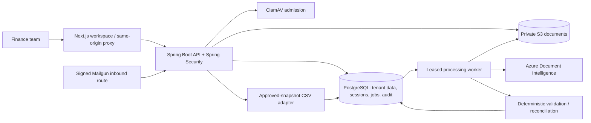

# Architecture



## Boundaries

- `domain`: canonical invoice/line records, GSTIN checksum, deterministic financial rules, findings and errors. No framework or provider SDK dependencies.
- `application`: intake, evaluation, immutable versioning, workflow transitions, allocation, history, notification and export orchestration. Ports isolate extraction, object storage and accounting output.
- `infrastructure`: explicit JDBC persistence, transaction helper, Azure HTTP adapter/normalizer, S3 adapter, document admission, CSV serialization and durable worker.
- `security`: authenticated membership, role permissions, session/CSRF configuration, optional OIDC subject linkage, request rate limiting and correlation.
- `api`: operation-specific request records, validation/error translation and REST resources.

JDBC is an intentional deviation from the recommended JPA baseline: tenant predicates and critical locking SQL are explicit. PostgreSQL JSONB holds full immutable financial snapshots; exact numeric indexed columns support search and PO balances. There is no Redis, SQS or microservice dependency in P0.

## Tenant authorization

The client supplies `X-Organization-ID` as a requested organization, never as trusted authority. `Access.require` resolves the authenticated principal and verifies current membership and permission before each tenant operation. Object bytes are only returned after invoice ownership is checked. Composite tenant foreign keys protect supplier/PO/version/allocation references. Notifications additionally require the recipient user ID.

| Role | Read | Upload/edit | Master data | Resolve | Approve | Export | Administration |
|---|---|---|---|---|---|---|---|
| Organization / platform administrator | Yes | Yes | Yes | Yes | Yes | Yes | Yes |
| Finance manager | Yes | Yes | Yes | Yes | Yes | Yes | No |
| Processor | Yes | Yes | Yes | No | No | No | No |
| Reviewer | Yes | Edit only | No | Yes | No | No | No |
| Approver | Yes | No | No | No | Assigned invoices | No | No |
| Auditor | Yes | No | No | No | No | No | No |

Platform administrator remains membership-scoped; no global tenant-bypass endpoint exists. The accounting-firm use case is multiple explicit memberships with organization-scoped frontend cache keys.

## Financial transactions

```mermaid
sequenceDiagram
  participant A as Assigned approver
  participant S as Invoice service
  participant D as PostgreSQL
  A->>S: approve(invoice, expected version)
  S->>D: BEGIN; lock organization and invoice
  S->>D: Check submitted state, membership, separation of duties
  S->>D: Re-evaluate current rules, duplicate evidence and PO balances
  S->>D: Reserve approved business identity
  S->>D: Lock PO lines in stable order; insert allocations
  S->>D: Persist decision, approved version, audit
  S->>D: COMMIT
```

The organization lock serializes approval/allocation and PO amendment decisions within one tenant. This is deliberately conservative and testable; benchmark contention before replacing it with narrower locks. Reads and external extraction calls do not hold this lock. Allocations occur only on approval, never on AI suggestions. Reopening an unexported invoice releases its allocations and identity reservation; prepared/exported snapshots prevent reopening.

Invoice versions are immutable by database trigger. Material edits append a version, invalidate pending submission, and create fresh evaluation history. Approval references a specific version. Export preparation locks the organization, verifies approval, reserves exact version references and snapshots field order. CSV generation runs outside the preparation transaction. The final transaction stores bytes/checksum and marks invoices exported. Failures preserve the same batch for retry. Concurrent generators cannot create two completions.

CSV artifacts are stored as immutable-through-application PostgreSQL bytea batches rather than S3 objects. This keeps artifact/state completion atomic for bounded 100-record exports. Source documents use S3. Move large accounting artifacts to a recoverable object-key protocol if export sizes grow.

## Processing

Upload order is admission → private object write → invoice/job/audit transaction. A failed database transaction may leave an orphan object; accepted documents cannot lose their object silently. No automatic destructive orphan cleanup is included.

The worker claims ready/expired jobs with `FOR UPDATE SKIP LOCKED`, increments attempts, grants a 10-minute lease and assigns a random fencing token. Provider calls happen outside database transactions. Completion checks the fencing token under lock. Three attempts with exponential delay and jitter lead to a visible terminal failure. Reprocessing always saves a separate extraction run; only the first extraction initializes the draft. Existing human versions remain intact.

Current worker concurrency is one per process. Additional processes can safely claim different jobs. A long retry loop has bounded HTTP timeouts but throughput still needs load testing. The worker does not claim exactly-once provider billing: a crash after provider acceptance can result in a repeated paid call.

## Version and dependency decisions

Verified against official documentation on 2026-10-30:

- Spring Boot 3.5.16 supports Java 17–25; Java 21 is selected: https://docs.spring.io/spring-boot/3.5/system-requirements.html
- springdoc 2.8.17 follows the 2.8.x / Boot 3.5.x compatibility line: https://springdoc.org/
- Next.js 16.4.3 requires Node 20.9 or newer; Node 24 is selected: https://nextjs.org/docs/app/getting-started/installation

Versions are pinned in the Maven parent, Maven wrapper and npm lockfile. A newer Boot major is not needed for this application.
