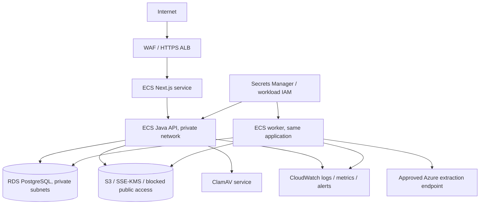

# Deployment reference and Well-Architected review

## AWS production reference

This is a deployment **reference**, not an applied AWS environment. No cloud resources have been created or billed.

- Run frontend and backend as non-root images. Build the frontend with `BACKEND_URL` set to the private backend address: Next.js rewrite destinations are compiled at build time.
- Restrict the API to the frontend/load balancer and the email webhook path to the verified receiving provider route. Strip untrusted forwarding headers at the ingress. Configure WAF authentication/webhook limits independently of per-instance limits.
- Use two private database subnets, encrypted RDS, PITR, no public DB access, bounded pools and a separate migration role. The current local Compose database owner is a development convenience, not the production role design.
- Use workload IAM credentials for S3, least-privilege bucket prefixes, KMS, versioning and lifecycle. Keep storage keys opaque. Do not deploy LocalStack as a production object store.
- Set HTTPS URLs, `SECURE_COOKIES=true`, OIDC and a verified provider region/data-processing agreement. Configure encryption of PostgreSQL exports/backups and all traffic.
- Set `WORKER_ENABLED=false` on API-only replicas; enable it on one or more worker replicas. Each worker currently processes one job at a time. Jobs use database leases and fencing tokens, so multiple replicas can claim independent jobs.
- Run Flyway migrations in a controlled release job; disable Flyway on application replicas after migrating if rollout policy requires it. Keep database version and application version compatible; never alter already-applied migrations.
- Add database/job queue age alerts, extraction error/retry alerts, scanner outage monitoring, object access alarms and export failure monitoring. Basic Actuator endpoints are provided; distributed tracing, provider-cost metrics and operational alert rules need environment configuration.
- Before customer rollout, validate restore procedures, provider behavior on a representative corpus, tenant isolation with multiple memberships, a production threat review and capacity at the expected concurrency.

## Six pillars

| Pillar | Current evidence | Risks and required follow-up |
|---|---|---|
| Operational excellence | Reproducible wrappers/lockfile, migrations, CI workflow, test fixtures, basic health, persisted job/run/error history, runbook and traceability | CI itself has not run in a hosted runner; add deployment automation, alert ownership, request traces and restore drills |
| Security | Backend membership/RBAC, CSRF/JDBC sessions, immutable history triggers, checksum/content/page validation, ClamAV, private S3 access, formula-safe CSV, real signature verification | OIDC/live email unverified; password recovery/email verification absent; production DB/IAM roles and gateway rate limits required; no independent security audit |
| Reliability | At-least-once fenced jobs, bounded retries, approved-version exports, retryable batches, stale-update protection, concurrent allocation test | Provider acceptance/worker crash can repeat provider consumption; orphan object reconciliation is manual; no measured RPO/RTO |
| Performance efficiency | Server-side paging/filtering, tenant indexes, async extraction, bounded workers, PO locks, 100-document integration test | Organization-level financial lock trades throughput for simplicity; load/p95 and provider turnaround targets remain unmeasured |
| Cost optimization | Modular monolith, no Redis/SQS requirement, original-byte dedupe evidence, reprocessing explicit, 100-record export cap | Real provider pricing/consumption dashboards absent; configure storage lifecycle and test cost per invoice before sales commitments |
| Sustainability | Bounded worker concurrency, safe retries, snapshot reuse for exports, no speculative heavy infrastructure | Duplicate uploads still incur extraction unless an operator prevents it; capacity/storage lifecycle requires operational tuning |

## Local verification is not production certification

The local stack was exercised with PostgreSQL, LocalStack S3, ClamAV and a test-only extraction adapter. Real Azure, Mailgun, OIDC, cloud backup/restore and production networking are separate acceptance gates. Performance targets of 500 ms read p95 and two-minute document processing are not claimed as achieved.
